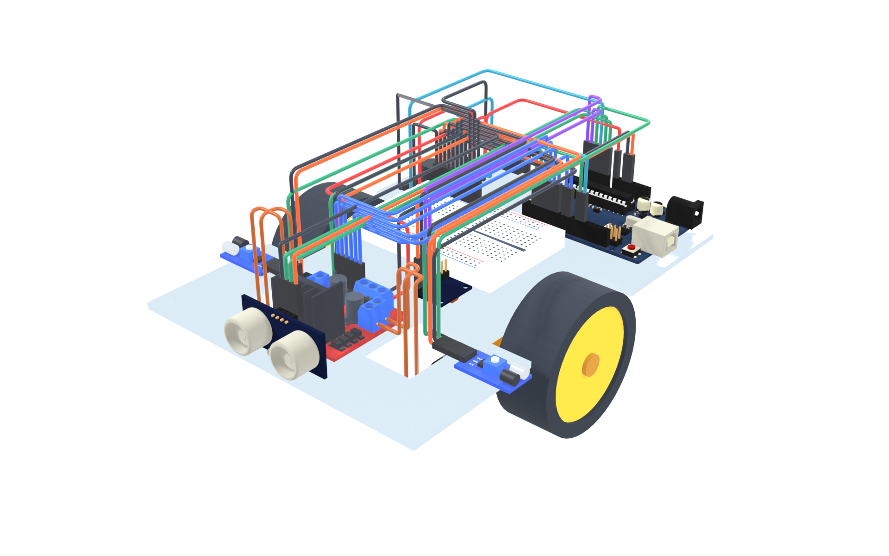

# Robot Navigasi Otonom — Praktikum Robotika (TC253421)

Dokumentasi pengguna dan panduan praktikum lengkap untuk sistem **Robot Navigasi Otonom** (*Autonomous Mobile Robot Navigation*), Program Studi **D3 Teknik Komputer, Politeknik Negeri Sriwijaya (Polsri)**.

Proyek ini berisi firmware mikrokontroler (*Arduino Uno R3* dan portabilitas *ESP32*), simulator kinematika offline berbasis C++ & Python, plotter lintasan SVG, serta *wizard* kalibrasi otomatis berbasis CLI yang menyimpan parameter kalibrasi langsung ke EEPROM tanpa perlu kompilasi ulang.

---

## Daftar Isi

1. [Gambaran Umum Sistem](#1-gambaran-umum-sistem)
2. [Struktur Repositori](#2-struktur-repositori)
3. [Requirements & Prasyarat](#3-requirements--prasyarat)
   - [A. Kebutuhan Perangkat Lunak (Laptop/PC)](#a-kebutuhan-perangkat-lunak-laptoppc)
   - [B. Kebutuhan Perangkat Keras (Hardware Robot)](#b-kebutuhan-perangkat-keras-hardware-robot)
   - [C. Peralatan Ukur & Arena Praktikum](#c-peralatan-ukur--arena-praktikum)
4. [Tutorial Lengkap Langkah-demi-Langkah](#4-tutorial-lengkap-langkah-demi-langkah)
   - [Langkah 1: Verifikasi Lingkungan Kerja (Offline)](#langkah-1-verifikasi-lingkungan-kerja-offline)
   - [Langkah 2: Menjalankan Simulasi & Plot Lintasan (Tanpa Robot Fisik)](#langkah-2-menjalankan-simulasi--plot-lintasan-tanpa-robot-fisik)
   - [Langkah 3: Perakitan Hardware, Skematik Kabel, Power Rail, & Pinout](#langkah-3-perakitan-hardware-skematik-kabel-power-rail--pinout)
     - [C. Model 3D Rangkaian & Perkabelan (Blender, Opsional)](#c-model-3d-rangkaian--perkabelan-blender-opsional)
   - [Langkah 4: Konfigurasi & Upload Firmware ke Mikrokontroler](#langkah-4-konfigurasi--upload-firmware-ke-mikrokontroler)
   - [Langkah 5: Uji Pre-Flight & Kalibrasi Otomatis (`auto_calibrate.py`)](#langkah-5-uji-pre-flight--kalibrasi-otomatis-auto_calibratepy)
   - [Langkah 6: Menjalankan Robot di Arena Navigasi](#langkah-6-menjalankan-robot-di-arena-navigasi)
5. [Kalibrasi Manual Alternatif (`Uji_Encoder` & `Uji_MPU6050`)](#5-kalibrasi-manual-alternatif-uji_encoder--uji_mpu6050)
6. [Referensi Protokol Serial ASCII](#6-referensi-protokol-serial-ascii)
7. [Pemecahan Masalah (Troubleshooting)](#7-pemecahan-masalah-troubleshooting)
8. [Referensi Dokumentasi Teknis](#8-referensi-dokumentasi-teknis)

---

## 1. Gambaran Umum Sistem

Robot bergerak secara otonom menggunakan sistem penggerak *differential drive* (2 roda penggerak independen + 1 *caster wheel*) dari titik awal **`START (0, 0)`** sepanjang koridor berukuran **`480 × 80 cm`** (`x ∈ [0, 480] cm`, `y ∈ [-40, +40] cm`) menuju salah satu dari **4 Ruangan Tujuan (Goal Room 1–4)**.

### Fitur Utama
- **Estimasi Posisi (*Odometry*):** Menggabungkan jumlah pulsa *optical encoder* roda kiri/kanan (jarak translasi) dengan integrasi laju sudut sumbu-Z *gyroscope* MPU6050 (orientasi $\theta$).
- **Kontrol Gerak (*MotionController*):** Kendali proporsional *Go-to-Goal* dengan penstabil arah (*heading hold*), perlambatan halus saat mendekati target (`JARAK_DECEL_CM = 30 cm`), dan penengah koridor (*wall-centering*) dari dua sensor IR lateral.
- **Penghindaran Rintangan (*Obstacle Avoidance*):** Saat sensor ultrasonik mendeteksi halangan di depan pada jarak $< 25\text{ cm}$ (saat bergerak lurus di koridor dengan $|\theta| < 20^\circ$), robot berhenti, memindai sisi kiri/kanan ($\pm 30^\circ$), menyisipkan jalur *bypass* sementara (*Temporary Waypoint* dengan offset jalur $\pm 20\text{ cm}$), lalu kembali menuju target utama.
- **Finite State Machine (8 State):**
  1. `IDLE` — Menunggu pemilihan ruangan (`1`–`4`) atau perintah kalibrasi serial, serta penekanan tombol `START`.
  2. `KALIBRASI` — Mengambil sampel *zero-bias* gyroscope selama 2 detik dalam keadaan diam sebelum bergerak.
  3. `ORIENTASI` — Berputar di tempat (*in-place*) hingga arah hadap sejajar dengan waypoint aktif ($\text{galat} \le 8^\circ$).
  4. `MAJU` — Bergerak menuju waypoint dengan koreksi arah proporsional dan deteksi rintangan aktif.
  5. `PINDAI` — Memindai celah bebas di sisi kiri dan kanan saat terdeteksi halangan di depan.
  6. `MUNDUR` — Mundur sejauh `15 cm` jika kedua sisi pemindaian terhalang untuk mencari ruang manuver baru.
  7. `TIBA` — Robot mencapai pusat ruangan tujuan (LED menyala solid + bunyi buzzer 3x beep).
  8. `GAGAL` — *Failsafe* aktif jika terjadi kondisi berbahaya (LED berkedip cepat + buzzer kontinu 2 detik).
- **4 Perlindungan *Failsafe* Otomatis:**
  - *Global Timeout:* Waktu navigasi melebihi `90 detik`.
  - *Motor Stall Watchdog:* Motor aktif tetapi tidak ada pulsa encoder selama $\ge 1.0\text{ detik}$ (melindungi IC L293D dari arus *stall*).
  - *Boundary Excursion:* Robot keluar batas koridor (`|y| > 40 cm` sebelum masuk pintu ruangan atau `x < -30 cm`).
  - *Entrapment:* Gagal mencari jalan keluar setelah `> 3` kali percobaan mundur/menghindar.

### Peta Koordinat Ruangan Tujuan (Arena 480 × 80 cm)

| Ruangan | Sisi Koridor | Waypoint Pintu Masuk (`WP1`) | Waypoint Pusat Ruangan (`WP2`) |
| :--- | :---: | :---: | :---: |
| **Room 1** | Kiri (`+Y`) | `(180, 0) cm` | `(180, +70) cm` |
| **Room 2** | Kiri (`+Y`) | `(295, 0) cm` | `(295, +70) cm` |
| **Room 3** | Kanan (`-Y`) | `(235, 0) cm` | `(235, -70) cm` |
| **Room 4** | Kanan (`-Y`) | `(355, 0) cm` | `(355, -70) cm` |

> **Sistem koordinat (sesuai brief):** `START = (0, 0)`, sumbu `+X` ke depan sepanjang koridor, sumbu **`+Y` ke kiri** robot, dan sudut positif = belok kiri (berlawanan jarum jam). Jadi saat robot berdiri di START menghadap ke dalam koridor, **Room 1 & 2 ada di sisi kiri**, **Room 3 & 4 di sisi kanan**.

---

## 2. Struktur Repositori

```text
.
├── Makefile                            # Otomatisasi lint, unit test C++/Python, & simulasi
├── CODING_STANDARDS.md                 # Aturan standar penulisan kode C++ & Python
├── GLOSSARY.md                         # Kamus istilah domain navigasi & kalibrasi
├── Brief_Tugas_Akhir_Robot_Navigasi_Otonom.pdf
├── firmware/
│   ├── RobotNavigasiOtonom/            # Firmware utama robot (Arduino Uno R3 / ESP32)
│   │   ├── RobotNavigasiOtonom.ino     # Entry point setup() & loop() 20 ms deterministik
│   │   ├── Config.h                    # Pinout, parameter fisik sasis, kontrol, & koordinat ruangan
│   │   ├── Hal.h / Hal.cpp             # Hardware Abstraction Layer (Arduino/ESP32 & mock desktop)
│   │   ├── NavigationFSM.h / .cpp      # Mesin status 8-state & 4 failsafe
│   │   ├── MotionController.h / .cpp   # Kontrol arah, perlambatan, dan wall-centering
│   │   ├── Odometry.h / .cpp           # Fusi encoder + gyroscope
│   │   ├── WaypointQueue.h / .cpp      # Antrian waypoint FIFO kapasitas statis
│   │   ├── ObstacleAvoidance.h / .cpp  # Pemindaian rintangan & penyisipan jalur bypass
│   │   ├── Motors.h / .cpp             # Driver PWM L293D + trim & inversi polaritas
│   │   ├── Gyroscope.h / .cpp          # Driver I2C MPU6050
│   │   ├── UltrasonicSonar.h / .cpp    # Driver HC-SR04 non-blocking
│   │   ├── WallDetector.h / .cpp       # Driver sensor IR lateral FC-51
│   │   ├── CalibrationProfile.h / .cpp # Struct EEPROM persisten (magic 0xCA1B + CRC-8)
│   │   ├── CalibrationService.h / .cpp # Layanan diagnostik U0 & kalibrasi U1-U4 di firmware
│   │   ├── AsciiProtocolDecoder.h/.cpp # Parser perintah serial ASCII ('!...') & ruang ('1'-'4')
│   │   ├── TripRecorder.h / .cpp       # Simpan jarak dorong tangan ke EEPROM (kalibrasi diameter tanpa USB)
│   │   ├── EncoderGlitchFilter.h       # Filter derau PWM motor pada pulsa encoder (level harus bertahan ≥1 ms)
│   │   └── FloatText.h                 # Format/parse float tanpa "%f" (printf AVR Arduino tak mendukung float)
│   ├── Uji_Encoder/                    # Sketch uji mandiri U1 (encoder & diameter roda)
│   └── Uji_MPU6050/                    # Sketch uji mandiri U2 (gyroscope & rotasi 90°)
├── tools/
│   ├── README.md                       # Ringkasan utilitas CLI host
│   ├── auto_calibrate.py               # Wizard interaktif Pre-Flight (U0) & Kalibrasi (U1-U4)
│   ├── calibration/                    # Paket modular wizard kalibrasi (engine, formulas, adapters)
│   ├── simulate_navigation.py          # Runner simulasi kinematika arena 480x80 cm
│   ├── sim_navigation.cpp              # Harness simulasi native C++ (menggunakan kode firmware asli)
│   ├── plot_trajectory.py              # Generator grafik lintasan vektor (.svg) dari telemetri CSV
│   ├── check_python_standards.py       # Pemeriksa type-hint & isolasi modul Python
│   ├── check_docs_consistency.py       # Pemeriksa konsistensi README.md & docs/ terhadap kode
│   └── blender/                        # Pembangun model 3D robot + 41 kabel (netlist, layout, rute, Blender)
├── assets/3d/                          # Manifest model 3D (sources.json), koordinat pin (anchors.json), SOURCES.md
├── tests/                              # Unit test C++ (9 suite) & Python (test_auto_calibrate.py, test_blender_*.py)
└── docs/
    ├── hardware/                       # pinout.md, power-budget.md, wiring-schematic.md & renders/ (gambar model 3D)
    ├── calibration/                    # protocols-u1-u4.md
    └── adr/                            # Architecture Decision Records (ADR-0001 s.d. ADR-0008)
```

---

## 3. Requirements & Prasyarat

Pastikan seluruh kebutuhan perangkat lunak dan perangkat keras berikut telah siap sebelum memulai praktikum.

### A. Kebutuhan Perangkat Lunak (Laptop/PC)

| Kebutuhan | Versi / Detail | Kegunaan | Wajib Untuk |
| :--- | :--- | :--- | :--- |
| **Sistem Operasi** | macOS, Linux (Ubuntu/Debian), atau Windows 10/11 | Lingkungan pengembangan utama | Semua pengguna |
| **Arduino IDE** | v1.8.19+ atau v2.x (atau `arduino-cli`) | Kompilasi & upload firmware ke MCU | Pengguna robot fisik |
| **Board Package ESP32** *(Opsional)* | `esp32` by Espressif via Boards Manager | Hanya jika memakai papan **ESP32 DevKit v1** | Pengguna ESP32 |
| **Python** | **Python 3.8+** | Menjalankan simulator, plotter SVG, & wizard kalibrasi | Semua pengguna |
| **Pustaka Python `pyserial`** | `pip install pyserial` | Komunikasi serial USB dengan robot pada `auto_calibrate.py` | Kalibrasi robot fisik |
| **Compiler C++ & Make** | `clang++` (C++11) dan `make` | Kompilasi `sim_navigation` dan menjalankan `make check` / unit test C++ | Simulasi & pengujian |
| **`timeout` / `gtimeout`** *(Opsional)* | GNU coreutils | Batas waktu eksekusi test otomatis di `Makefile` | Menjalankan `make test` |
| **Blender** *(Opsional)* | **5.3** (`/Applications/Blender.app` atau set `BLENDER=...`) | Membangun & merender model 3D rangkaian (`make blender_model`) | Model 3D |
| **Python 3.12** *(Opsional)* | `python3.12` + koneksi internet (sekali) | Konverter STEP → GLB (`cadquery-ocp` dipasang otomatis ke `.venv/`) dan unduhan model (`make blender_fetch`) | Model 3D |

> **Catatan Library Arduino:** Firmware `RobotNavigasiOtonom` hanya menggunakan pustaka standar bawaan Arduino (`Arduino.h`, `Wire.h`, `EEPROM.h`), sehingga **tidak memerlukan instalasi library pihak ketiga** di Arduino IDE.

#### Cara Instalasi Prasyarat Software

- **macOS:**
  ```bash
  # 1. Install Xcode Command Line Tools (menyediakan clang++, make, dan git)
  xcode-select --install

  # 2. Pastikan Python 3 tersedia, lalu install pyserial (untuk koneksi robot fisik)
  python3 --version
  pip3 install pyserial
  ```
- **Linux (Ubuntu / Debian):**
  ```bash
  sudo apt update
  sudo apt install -y clang make python3 python3-pip
  pip3 install pyserial
  # Tambahkan user ke grup dialout agar port /dev/ttyUSB0 atau /dev/ttyACM0 bisa diakses tanpa sudo
  sudo usermod -aG dialout $USER
  ```
  *(Logout dan login kembali setelah menjalankan perintah `usermod`.)*
- **Windows:**
  - Install **Arduino IDE** dari situs resmi Arduino.
  - Install **Python 3** (centang *"Add Python to PATH"* saat instalasi), lalu jalankan `pip install pyserial` di Command Prompt / PowerShell.
  - Untuk menjalankan simulasi C++ dan `Makefile` di Windows, gunakan **WSL (Ubuntu)** atau **MSYS2/Git Bash** dengan paket `clang` dan `make` terpasang.

---

### B. Kebutuhan Perangkat Keras (Hardware Robot)

#### 1. Mikrokontroler (Pilih Salah Satu)
- **Arduino Uno R3 (ATmega328P)** — *Target baseline evaluasi praktikum*.
- **ESP32 DevKit v1** — *Target alternatif* (memerlukan pengubahan `BOARD_TYPE` di `Config.h` serta *voltage divider* 5V ke 3.3V pada pin Echo HC-SR04).

#### 2. Komponen Elektronik, Sensor, & Aktuator
- **1x Driver Motor L293D Dual H-Bridge**
- **2x Motor DC Gearbox TT Kuning (rasio 1:48)** + **2x Roda Karet** ($\varnothing \approx 65\text{ mm}$) + **1x Caster Wheel**
- **2x Sensor Optical Speed Encoder LM393 (FC-03)** + **2x Cakram Encoder 20 Slot**
- **1x Sensor IMU MPU6050** (modul **GY-521**, Gyroscope + Accelerometer I2C, alamat `0x68`)
- **1x Sensor Ultrasonik HC-SR04** (pendeteksi rintangan depan)
- **2x Sensor IR Proximity FC-51** (sensor dinding koridor kiri & kanan, *active-LOW*)
- **1x Push Button Tactile** (tombol `START`)
- **1x Buzzer Aktif 5V** (indikator suara tiba & failsafe)
- **1x Modul Bluetooth HC-05** *(opsional; berbagi `Serial` UART0 di pin `D0`/`D1` dengan USB, pada `SERIAL_BAUD` = `9600` baud bawaan pabrik HC-05 — lihat catatan HC-05 di Langkah 3)*

##### Panduan Pemilihan & Pemahaman Modul MPU6050 (GY-521)
Agar tidak salah memilih modul saat membeli maupun saat merangkai:
- **Gunakan modul `GY-521` berchip `MPU-6050`:** Pastikan varian yang dibeli benar-benar **MPU6050** (umumnya PCB biru dengan 8 pin: `VCC`, `GND`, `SCL`, `SDA`, `XDA`, `XCL`, `AD0`, `INT`, serta regulator `3.3V` onboard sehingga aman disuplai `5V`). **Jangan** memilih varian **MPU6500** atau **MPU9250**, karena nilai identitas register `WHO_AM_I`-nya berbeda sehingga akan gagal pada verifikasi `U0.1`. *(Catatan: beberapa penjual menulis kata "analog" pada judul produk karena mengacu pada fitur 16-bit ADC internal chip—pastikan jalur komunikasinya adalah **I2C / IIC**.)*
- **Pin header wajib tersolder:** Banyak modul GY-521 dijual dengan pin header terpisah. Pin header **harus disolder rapat** ke PCB (jangan hanya diselipkan), karena getaran motor akan membuat jalur I2C putus-putus saat robot berjalan.
- **Arti alamat `0x68` (I2C & `WHO_AM_I`):**
  - **`0x68`** adalah **alamat I2C** standar MPU6050 (dalam heksadesimal) agar Arduino/ESP32 tahu perangkat mana yang dipanggil pada bus `SDA`/`SCL` ([`Config.h`](firmware/RobotNavigasiOtonom/Config.h)).
  - Alamat ini diatur oleh pin **`AD0`**: jika `AD0` **dibiarkan kosong atau disambung ke `GND`**, alamatnya tetap **`0x68`**; jika `AD0` disambung ke `VCC`, alamatnya berubah menjadi `0x69` sehingga tidak terbaca oleh firmware.
  - Selain sebagai alamat bus, chip MPU6050 yang sehat juga mengembalikan nilai **`0x68`** saat firmware membaca register identitas **`WHO_AM_I` (`0x75`)** pada [`Gyroscope.cpp`](firmware/RobotNavigasiOtonom/Gyroscope.cpp).
- **Pemasangan fisik:** Tempel modul **datar dan sejajar** dengan sasis robot (tidak miring) agar gyroscope sumbu-Z mengukur sudut belok (*yaw*) secara akurat.

#### 3. Catu Daya & Komponen Proteksi Derau (Wajib)
- **Baterai 2S Li-Ion 18650** (tegangan nominal `7.4 V`, penuh `8.4 V`, kapasitas $\ge 2200\text{ mAh}$) + **Holder Baterai** + **Switch ON/OFF Utama**
  - *Alternatif 3S (`11.1 V`, penuh `12.6 V`):* boleh dipakai — set `TEGANGAN_BATERAI_V` di `Config.h` agar PWM motor dikompensasi otomatis (lihat Langkah 4). Regulator onboard Arduino akan panas jika `VIN` langsung diberi `12.6 V` dengan beban semua sensor; disarankan memakai *buck converter* yang diset `7.5 V` ke `VIN`.
- **Regulator 5V eksternal (LM7805 / Buck Converter)** atau suplai melalui pin `Vin` Arduino Uno
- **4x Resistor $220\,\Omega$** (jalur sinyal arah `IN1`–`IN4` ke L293D)
- **1x Kapasitor Elektrolit $100\,\mu\text{F} - 220\,\mu\text{F}$ (16V/25V)** (dipasang pada pin 8 `VCC2` L293D ke GND)
- **3x Kapasitor Keramik $100\text{ nF}$ ($0.1\,\mu\text{F}$)** (1 buah pada pin 16 `VCC1` L293D ke GND; 2 buah disolder langsung pada terminal masing-masing motor DC untuk meredam percikan EMI)
- **Resistor Voltage Divider ($1\,\text{k}\Omega$ & $2\,\text{k}\Omega$)** (wajib jika menggunakan ESP32 pada pin `Echo` HC-SR04 atau pin `RX` Bluetooth HC-05 agar tegangan 5V turun ke 3.3V)
- **Kabel USB Data** (USB-B untuk Arduino Uno atau Micro-USB/USB-C untuk ESP32)

---

### C. Peralatan Ukur & Arena Praktikum

Untuk menjalankan protokol kalibrasi fisik (U1–U4), siapkan:
1. **Meteran pita atau penggaris panjang** (minimal 100–150 cm).
2. **Busur derajat lantai** atau tanda sudut siku $90^\circ$ pada lantai/keramik.
3. **Kotak rintangan kardus** ukuran standar **`20 × 20 cm`**.
4. **Lakban kertas/selotip** untuk menandai garis `START (0 cm)`, garis `100 cm`, dan garis acuan lurus `150 cm`.
5. **Penyangga/ganjal sasis** (kotak kecil untuk mengangkat roda robot saat pengujian awal U0.5 agar robot tidak langsung meluncur di meja).

---

## 4. Tutorial Lengkap Langkah-demi-Langkah

### Langkah 1: Verifikasi Lingkungan Kerja (Offline)

Masuk ke direktori root proyek di terminal, lalu jalankan perintah verifikasi menyeluruh:

```bash
make check
```

Perintah `make check` otomatis menjalankan 3 tahap:
1. **`make lint`**: Memeriksa tidak ada `delay()` yang memblokir di algoritma firmware, validasi sintaks Python, dan pengecekan standar tipe Python.
2. **`make test`**: Mengompilasi dan menjalankan seluruh **9 suite unit test C++** (`tests/test_*`) serta **46 unit test Python** (`tests/test_auto_calibrate.py`), ditambah tes model 3D (`tests/test_blender_*.py`: netlist 41 kabel dicocokkan dengan `Config.h` & `wiring-schematic.md`, tata letak sasis, rute kabel, dan manifest model). Semuanya berjalan **tanpa Blender dan tanpa internet**.
3. **`make run_simulation`**: Mengompilasi simulator native C++ (`tools/sim_navigation`), menjalankan skenario navigasi standar, dan merender `tools/trajectory_plot.svg`.

Jika di akhir terminal muncul pesan:
```text
==========================================
 ALL REPOSITORY CHECKS & VERIFICATION PASSED!
==========================================
```
maka seluruh perangkat lunak di laptop Anda sudah siap digunakan.

---

### Langkah 2: Menjalankan Simulasi & Plot Lintasan (Tanpa Robot Fisik)

Sebelum menguji robot di lantai fisik, Anda dapat memverifikasi perilaku algoritma navigasi dan menghasilkan gambar lintasan untuk laporan praktikum.

#### A. Simulasi Standar (Semua Babak: Room 1–4)
```bash
python3 tools/simulate_navigation.py
```
Simulator akan mengeksekusi 4 skenario standar (Babak 1 tanpa rintangan, Babak 2 dengan 1 rintangan, Babak 3 dengan 2 rintangan, dan Babak 3 Alternatif) menggunakan **kode firmware C++ asli** (`NavigationFSM`, `MotionController`, `ObstacleAvoidance`, `Odometry`, `WaypointQueue`) dan mengekspor telemetri Room 1 ke `tools/sample_telemetry.csv`.

#### B. Simulasi Ruangan & Rintangan Kustom + Plot SVG Otomatis
Format argumen rintangan adalah `'x,y,lebar,tinggi'` dalam satuan cm:
```bash
# Simulasi menuju Room 2 dengan 1 rintangan 20x20 cm di koordinat (110, 0) dan langsung buat grafik SVG:
python3 tools/simulate_navigation.py --room 2 --obs "110,0,20,20" --plot

# Simulasi Room 3 dengan 2 rintangan dan simpan SVG ke nama file khusus:
python3 tools/simulate_navigation.py --room 3 --obs "80,0,20,20" --obs "160,0,20,20" --plot --svg hasil_babak3.svg
```

#### C. Membuat Grafik Lintasan dari File CSV Telemetri Robot Asli
Jika Anda merekam output serial saat robot fisik berjalan (format kolom: `t_ms,state,x,y,theta,jarak,iWp`) ke dalam file CSV (misal `telemetri_robot.csv`), Anda dapat memplotkannya dengan:
```bash
python3 tools/plot_trajectory.py telemetri_robot.csv -o lintasan_robot.svg
```
Buka file `.svg` menggunakan browser (Chrome/Firefox/Safari) untuk melihat garis lintasan biru, posisi `START`, batas koridor `480 × 80 cm`, target lingkaran ruangan hijau, dan titik `TIBA` merah.

#### D. Mencoba Wizard Kalibrasi dalam Mode Simulasi (`--mock`)
Untuk berlatih alur wizard kalibrasi sebelum menghubungkan robot fisik:
```bash
# Mode interaktif simulasi (Anda dapat mencoba menjawab pertanyaan wizard):
python3 tools/auto_calibrate.py --mock

# Mode otomatis tanpa input keyboard (cocok untuk uji cepat):
python3 tools/auto_calibrate.py --mock --headless

# Simulasi kasus sensor MPU6050 rusak atau roda kiri terbalik:
python3 tools/auto_calibrate.py --mock --fail-mpu
python3 tools/auto_calibrate.py --mock --reverse-left
```

---

### Langkah 3: Perakitan Hardware, Skematik Kabel, Power Rail, & Pinout

> **Panduan Visual & Langkah Perakitan Anti-Salah:** Ikuti panduan perakitan 5 tahap beserta diagram skematik visual lengkap pada **[docs/hardware/wiring-schematic.md](docs/hardware/wiring-schematic.md)** (Arduino Uno R3 + Modul L298N).

#### A. Aturan Kelistrikan Wajib (*Dual Power Rail* & *Star Ground*)
Agar Arduino tidak mengalami *brownout* (restart sendiri) dan sensor MPU6050 tidak macet karena derau motor:
1. Pisahkan jalur daya motor (`VCC2` L293D langsung dari baterai 7.4V melalui sakelar utama) dengan jalur daya logika 5V (dari regulator 5V Arduino/Buck ke `VCC1` L293D, MPU6050, HC-SR04, LM393, FC-51).
2. Satukan seluruh kabel **Ground (GND)** pada **satu titik bersama (*Single-Point Star Ground*)** di dekat kutub negatif baterai. Hindari penyambungan GND secara berantai (*daisy-chain*) dari motor ke sensor.
3. Pasang kapasitor elektrolit $220\,\mu\text{F}$ pada pin `VCC2`–GND L293D, serta kapasitor keramik $100\text{ nF}$ pada `VCC1`–GND dan kedua kutub motor DC.

*(Detail kalkulasi arus dan daya tahan baterai dapat dilihat pada [docs/hardware/power-budget.md](docs/hardware/power-budget.md).)*

#### B. Tabel Pemetaan Pin (*Pinout*)

##### 1. Target Arduino Uno R3 (Default)

| Pin Arduino Uno | Driver L293D (IC) | Modul Driver L298N | Fungsi / Sinyal | Catatan Penting |
| :--- | :--- | :--- | :--- | :--- |
| **D9** | Pin 1 (`1,2EN`) | `ENA` *(lepas jumper)* | PWM Motor Kiri | Timer1 PWM (0–255) |
| **D8** | Pin 2 (`1A` / IN1) | `IN1` | Arah Motor Kiri | Pasang resistor seri $220\,\Omega$ jika memakai IC L293D |
| **D7** | Pin 7 (`2A` / IN2) | `IN2` | Arah Motor Kiri | Pasang resistor seri $220\,\Omega$ jika memakai IC L293D |
| **D6** | Pin 9 (`3,4EN`) | `ENB` *(lepas jumper)* | PWM Motor Kanan | Timer0 PWM (0–255) |
| **D5** | Pin 10 (`3A` / IN3) | `IN3` | Arah Motor Kanan | Pasang resistor seri $220\,\Omega$ jika memakai IC L293D |
| **D4** | Pin 15 (`4A` / IN4) | `IN4` | Arah Motor Kanan | Pasang resistor seri $220\,\Omega$ jika memakai IC L293D |
| **D2 (INT0)** | Encoder LM393 Kiri (`D0`) | — | Pulsa Encoder Kiri | Interupsi eksternal (`CHANGE` + filter glitch) |
| **D3 (INT1)** | Encoder LM393 Kanan (`D0`) | — | Pulsa Encoder Kanan | Interupsi eksternal (`CHANGE` + filter glitch) |
| **A0 (D14)** | HC-SR04 `Trig` | — | Trigger Ultrasonik | Output pulsa $10\,\mu\text{s}$ |
| **A1 (D15)** | HC-SR04 `Echo` | — | Echo Ultrasonik | Input pulsa gema (timeout 25 ms) |
| **A4 (SDA)** | MPU6050 `SDA` | — | I2C Data | Alamat perangkat `0x68` |
| **A5 (SCL)** | MPU6050 `SCL` | — | I2C Clock | Clock I2C |
| **A2 (D16)** | Buzzer Aktif (`+`) | — | Indikator Audio | Beep tiba & failsafe |
| **D12** | Push Button `START` | — | Tombol Mulai | Hubungkan ke GND (`INPUT_PULLUP`) |
| **D13** | Built-in LED | — | Indikator State | Kedip lambat (`IDLE`), solid (`MAJU`/`TIBA`), kedip cepat (`GAGAL`) |
| **A3 (D17)** | FC-51 Kiri (`OUT`) | — | Sensor Dinding Kiri | *Active-LOW* |
| **D11** | FC-51 Kanan (`OUT`) | — | Sensor Dinding Kanan | *Active-LOW* |
| **D0 (RX)** | HC-05 `TXD` | — | Bluetooth → Arduino | Berbagi `Serial` UART0 dengan USB (`SERIAL_BAUD` = `9600`) |
| **D1 (TX)** | HC-05 `RXD` | — | Arduino → Bluetooth | Lewat pembagi tegangan $1\,\text{k}\Omega$ / $2\,\text{k}\Omega$ (RXD HC-05 = 3.3V) |

> **Catatan Tambahan Jika Menggunakan Modul L298N:**
> - **Lepas jumper `ENA` dan `ENB`** pada modul L298N agar kecepatan motor bisa dikontrol oleh sinyal PWM (`D9` dan `D6`).
> - Hubungkan terminal **`+12V` (VCC)** L298N ke kutub positif baterai `7.4V` (via sakelar utama), terminal **`GND`** ke *Star Ground* bersama GND Arduino, dan terminal **`OUT1/OUT2`** ke Motor Kiri serta **`OUT3/OUT4`** ke Motor Kanan.
> - Jika **jumper regulator `5V-EN`** pada modul L298N terpasang, pin `5V` L298N berfungsi sebagai **output 5V** (jangan dihubungkan ke pin `5V` Arduino jika Arduino sudah mendapat daya dari regulator sendiri/USB; cukup satukan `GND`-nya saja). Jika jumper `5V-EN` dilepas, beri suplai logika `5V` ke pin `5V` L298N.
> - Pada modul L298N siap pakai (*breakout board*), resistor seri $220\,\Omega$ pada pin `IN1`–`IN4` tidak wajib karena sudah ada komponen pembatas/isolasi di PCB modul.

> **Catatan Modul Bluetooth HC-05 (Opsional):**
> - Sambungan: `VCC` → `+5V`, `GND` → GND bersama, `TXD` → **`D0` (RX)**, `RXD` ← **`D1` (TX)** melalui pembagi tegangan (`D1` —$1\,\text{k}\Omega$— titik —$2\,\text{k}\Omega$— GND; titik → `RXD`). Pin `EN`/`STATE` tidak dipakai.
> - Firmware memakai `SERIAL_BAUD` = **`9600`** ([`Config.h`](firmware/RobotNavigasiOtonom/Config.h)), sama dengan baud bawaan pabrik HC-05, sehingga **tidak perlu setting mode AT**. Jika HC-05 Anda pernah diubah (`AT+UART=...`), samakan `SERIAL_BAUD` dan jalankan wizard dengan `--baud <nilai>`.
> - HC-05 berbagi jalur serial dengan USB: **cabut kabel `TXD` HC-05 dari `D0` saat upload** (jika tidak, upload gagal `stk500_recv(): programmer is not responding`), dan cabut `VCC` HC-05 saat kalibrasi lewat kabel USB agar perintah dari laptop sampai ke Arduino.
> - Lewat Bluetooth (USB dicabut, robot dari baterai), pasangkan HC-05 di laptop (PIN bawaan `1234`), lalu gunakan port Bluetooth-nya (macOS: `/dev/cu.<nama-HC-05>`) untuk Serial Monitor, `auto_calibrate.py --port`, atau merekam telemetri.

##### 2. Target Alternatif: ESP32 DevKit v1

| Pin ESP32 | Driver L293D / L298N & Komponen | Fungsi | Catatan Penting |
| :--- | :--- | :--- | :--- |
| **GPIO 25 / 26 / 27** | L293D (`1,2EN`, `1A`, `2A`) / L298N (`ENA`, `IN1`, `IN2`) | Motor Kiri | PWM LEDC Ch 0 (1 kHz, 8-bit); lepas jumper `ENA` pada L298N |
| **GPIO 14 / 12 / 13** | L293D (`3,4EN`, `3A`, `4A`) / L298N (`ENB`, `IN3`, `IN4`) | Motor Kanan | PWM LEDC Ch 1 (1 kHz, 8-bit); lepas jumper `ENB` pada L298N |
| **GPIO 34 / 35** | Encoder LM393 Kiri / Kanan | Pulsa Encoder | Pin *input-only*, interupsi |
| **GPIO 5 / 18** | HC-SR04 `Trig` / `Echo` | Sensor Jarak Depan | **Wajib** pasang *voltage divider* (5V $\rightarrow$ 3.3V) pada `Echo`! |
| **GPIO 21 / 22** | MPU6050 `SDA` / `SCL` | I2C IMU | Hardware I2C default ESP32 |
| **GPIO 4 / 15 / 2** | Buzzer / Tombol START / Built-in LED | Antarmuka & Indikator | Buzzer 5V disarankan via transistor 2N2222 |
| **GPIO 32 / 33** | FC-51 Kiri / Kanan (`OUT`) | Sensor IR Dinding | Input digital (*Active-LOW*) |
| **GPIO 16 / 17** | Bluetooth HC-05 `TXD` / `RXD` | Komunikasi Serial *(cadangan)* | Didefinisikan di `Config.h`; firmware aktif memakai `Serial` UART0 |

#### C. Model 3D Rangkaian & Perkabelan (Blender, Opsional)

Untuk melihat rangkaian fisik sebelum merakit (atau untuk gambar laporan), repositori menyediakan **model 3D robot lengkap** varian **Arduino Uno R3 + L298N**. Model ini berisi sasis akrilik 2WD 210×150 mm, motor TT, roda Ø65 mm, holder 18650, semua sensor, dan **41 kabel yang menancap di pin yang benar** sesuai [docs/hardware/wiring-schematic.md](docs/hardware/wiring-schematic.md).



Gambar lainnya: [tampak atas](docs/hardware/renders/robot_top.png) dan [tampak bawah](docs/hardware/renders/robot_bottom.png).

**Cara membangun ulang** (butuh Blender 5.3 dan internet untuk unduhan pertama):
```bash
make blender_fetch   # unduh model komponen ke assets/3d/vendor/ (hash SHA-256 diverifikasi)
make blender_model   # konversi STEP, rakit robot, periksa kabel, simpan build/robot_3d.blend + render PNG
```
Baris terakhir yang menandakan sukses adalah `ROBOT MODEL OK: 41 wires, 25 parts`. Build **gagal** jika ada kabel yang ujungnya meleset lebih dari 0.5 mm dari pinnya, kabel yang menembus komponen atau kabel lain, housing dupont yang masuk ke komponen, atau ukuran model komponen yang meleset lebih dari 1 mm.

**Membuka model:** buka `build/robot_3d.blend` di Blender. Di Outliner, kabel dikelompokkan per tahap perakitan (*Wires → Tahap 1 – Daya … Tahap 5 – START & Buzzer*). Klik ikon mata untuk menampilkan atau menyembunyikan kabel per tahap, mengikuti urutan perakitan 5 tahap. Warna kabel mengikuti skematik: merah 7.4V, oranye 5V, hitam GND, biru sinyal motor, cokelat keluaran motor, hijau sensor, ungu I2C, dan biru muda START/buzzer.

> **Catatan saat merakit mengikuti model:**
> - Modul **MPU6050 (GY-521)** dan **HC-SR04** dipasang **terbalik** di model supaya pin header menghadap ke atas. Jika Anda merakit dengan cara yang sama, arah sumbu-Z gyroscope ikut terbalik; periksa hasil uji **U2** dan sesuaikan `GYRO_SIGN` di `Config.h` bila perlu.
> - Rel breadboard dipakai **berselang-seling**: kabel `+5V` di lubang ganjil, kabel `GND` di lubang genap, agar konektor tidak berdesakan. Secara listrik setiap lubang pada satu rel tetap sama.
> - Model komponen unduhan **tidak disertakan di git** (sebagian tanpa lisensi redistribusi). Sumber, lisensi, dan atribusinya ada di [assets/3d/SOURCES.md](assets/3d/SOURCES.md). Penjelasan modul lengkap ada di [tools/README.md](tools/README.md#4-model-3d-rangkaian-blender-blender).

---

### Langkah 4: Konfigurasi & Upload Firmware ke Mikrokontroler

1. Buka file [`firmware/RobotNavigasiOtonom/RobotNavigasiOtonom.ino`](firmware/RobotNavigasiOtonom/RobotNavigasiOtonom.ino) menggunakan **Arduino IDE**. Semua file `.h` dan `.cpp` di folder tersebut akan otomatis terbuka sebagai tab.
2. Periksa file [`Config.h`](firmware/RobotNavigasiOtonom/Config.h) baris 12–14:
   - Jika memakai **Arduino Uno R3**, biarkan `#define BOARD_TYPE BOARD_ARDUINO_UNO` (nilai default).
   - Jika memakai **ESP32 DevKit v1**, ubah menjadi `#define BOARD_TYPE BOARD_ESP32`.
3. Periksa juga parameter dasar sasis di `Config.h` bila ukuran fisik sasis Anda berbeda jauh dari standar:
   - `DIAMETER_RODA_MM` (default `65.0f` mm)
   - `JUMLAH_SLOT_ENCODER` (default `20` slot)
   - `JARAK_RODA_MM` / *track width* jarak antar roda kiri-kanan (default `135.0f` mm)
   - `TEGANGAN_BATERAI_V` — tegangan nominal baterai yang terpasang (default `11.1f` untuk 3S 18650; ubah ke `7.4f` untuk 2S). Konstanta PWM disetel pada baterai 2S (`TEGANGAN_DESAIN_V`), sehingga `Motors::setMotor()` mengalikan setiap perintah PWM dengan $\frac{7.4 - 1.8}{V_{\text{baterai}} - 1.8}$ (`DROP_DRIVER_V` = `1.8 V` rugi tegangan H-bridge) agar kecepatan roda sama di baterai mana pun. Pada 3S, PWM `170` menjadi `102`.
   *(Catatan: `DIAMETER_RODA_MM`, trim motor, bias gyro, dan inversi motor dapat dikalibrasi otomatis nanti lewat `auto_calibrate.py` tanpa perlu mengedit `Config.h` lagi!)*
4. Di Arduino IDE, pilih **Tools → Board** sesuai papan Anda (`Arduino Uno` atau `ESP32 Dev Module`) dan pilih **Tools → Port** yang sesuai.
5. Klik tombol **Upload** ($\rightarrow$). Pastikan proses kompilasi dan upload selesai tanpa error.
6. *(Verifikasi cepat)* Buka **Serial Monitor** di Arduino IDE pada baud rate **`9600`** (`SERIAL_BAUD` di `Config.h`). Anda akan melihat pesan sambutan:
   ```text
   === ROBOT NAVIGASI OTONOM (POLSRI TC253421) ===
   Pilih Ruangan ('1'-'4'), lalu tekan START (D12).
   ```
   **Penting:** Tutup jendela Serial Monitor Arduino IDE sebelum menjalankan `auto_calibrate.py`, karena satu port serial tidak dapat dibuka oleh dua aplikasi secara bersamaan.

---

### Langkah 5: Uji Pre-Flight & Kalibrasi Otomatis (`auto_calibrate.py`)

Wizard `tools/auto_calibrate.py` menguji seluruh kabel sensor/aktuator (**Stage U0**) lalu mengkalibrasi kinematika robot (**Stage U1–U4**) dan menyimpannya secara permanen ke **EEPROM**.

#### Persiapan Sebelum Menjalankan Wizard
- Pastikan baterai robot terisi penuh (`~7.4V - 8.4V`) dan sakelar daya robot dalam posisi **ON**.
- Hubungkan Arduino Uno/ESP32 ke laptop menggunakan kabel USB data.
- Untuk tahap **U0** awal, **ganjal bagian bawah robot** agar roda bebas berputar di udara saat motor diuji.

#### Menjalankan Wizard
```bash
# Opsi 1: Jalankan alur lengkap otomatis (mendeteksi port serial secara otomatis)
python3 tools/auto_calibrate.py

# Opsi 2: Tentukan port serial secara eksplisit
# Contoh di Linux: /dev/ttyUSB0 atau /dev/ttyACM0
# Contoh di macOS: /dev/cu.usbmodem14101 atau /dev/cu.usbserial-1410
# Contoh di Windows: COM3
python3 tools/auto_calibrate.py --port /dev/ttyUSB0

# Opsi 3: Jalankan dalam mode menu interaktif (bisa pilih U0, U1, U2, U3, U4, atau lihat/reset EEPROM)
python3 tools/auto_calibrate.py --port /dev/ttyUSB0 --mode individual
```

#### Penjelasan Setiap Tahap di Dalam Wizard

1. **Stage U0 — Pre-Flight Hardware Diagnostics (*Hard-Gate*):**
   - **U0.1 MPU6050:** Mengecek respons alamat I2C `0x68` (`WHO_AM_I`).
   - **U0.2 Sonar HC-SR04:** Memastikan pantulan jarak valid (`2.0–400.0 cm`) tanpa timeout.
   - **U0.3 Sensor IR FC-51:** Dekatkan tangan ke sensor kiri dan kanan lalu konfirmasi ke wizard apakah LED modul FC-51 menyala saat dihalangi.
   - **U0.4 Buzzer & LED:** Konfirmasi buzzer berbunyi dan LED berkedip singkat.
   - **U0.5 Motor & Encoder:** Robot memutar roda kiri lalu kanan dan menghitung pulsa encoder. Wizard akan bertanya: *"Apakah RODA KIRI/KANAN berputar MAJU?"*. Jika salah satu roda ternyata berputar mundur karena kabel motor terbalik, jawab **`n`** — wizard akan otomatis menyimpan flag *Software Polarity Inversion* ke EEPROM tanpa Anda harus membongkar kabel!
   - *Aturan Keamanan:* Jika ada sub-tes U0 yang gagal, wizard akan **mengunci** pengujian gerak (`U1–U4`) dan menampilkan petunjuk pin kabel mana yang perlu diperiksa.

2. **Stage U1 — Kalibrasi Encoder & Diameter Roda (Target: 100 cm):**
   - Turunkan robot ke lantai datar dan posisikan roda tepat di garis `0 cm` pada lakban.
   - Wizard memerintahkan robot maju lurus sepanjang `100 cm` menurut estimasi firmware.
   - Ukur jarak fisik aktual dengan meteran pita, lalu masukkan angkanya ke terminal.
   - Jika galat jarak $> 3.0\text{ cm}$ atau selisih pulsa kiri vs kanan $> 3\%$, wizard otomatis menghitung ulang `DIAMETER_RODA_MM` dan rasio `TRIM_MOTOR_KIRI`/`KANAN`, menyimpannya ke EEPROM, dan meminta Anda mengulang pengujian (maksimal 5 iterasi hingga lulus).

3. **Stage U2 — Zero-Bias Gyroscope & Uji Rotasi $\pm 90^\circ$:**
   - Letakkan robot diam di atas busur derajat lantai pada posisi $0^\circ$.
   - Robot diam selama `2 detik` untuk mengambil rata-rata *zero-rate bias* gyroscope.
   - Robot berputar di tempat menuju $+90^\circ$ (dan/atau $-90^\circ$). Ukur sudut fisik aktual pada busur lantai dan masukkan ke wizard (syarat lulus: galat $\le 5.0^\circ$).

4. **Stage U3 — Uji Lintasan Lurus 150 cm Berpemandu Gyro:**
   - Posisikan robot pada garis acuan lurus sepanjang `150 cm`.
   - Robot melaju lurus sejauh `150 cm` dengan koreksi proporsional gyroscope aktif.
   - Ukur pergeseran menyamping (deviasi sumbu Y dari garis lurus) di titik akhir dan masukkan ke wizard (syarat lulus: $|y_{\text{deviasi}}| \le 5.0\text{ cm}$).

5. **Stage U4 — Uji Akurasi Sensor Ultrasonik HC-SR04:**
   - Letakkan kotak kardus `20 × 20 cm` tegak lurus di depan sensor pada jarak **10 cm**, **20 cm**, dan **40 cm** sesuai instruksi wizard.
   - Wizard membandingkan bacaan sonar terhadap jarak mistar (syarat lulus: galat $\le 1.0\text{ cm}$).

Setelah seluruh tahap selesai:
- Parameter terkalibrasi tersimpan permanen di **EEPROM** (dilindungi signature `0xCA1B` dan *checksum* CRC-8) dan otomatis dimuat setiap kali robot dinyalakan.
- Seluruh riwayat pengujian tercatat otomatis ke file [`tools/calibration_log.csv`](tools/calibration_log.csv) untuk lampiran laporan praktikum Anda.

---

### Langkah 6: Menjalankan Robot di Arena Navigasi

Setelah kalibrasi selesai, cabut kabel USB (robot siap berjalan otonom dengan baterai):

1. **Letakkan Robot di Titik Start:** Posisikan robot pada koordinat `(0, 0)` di tengah koridor menghadap lurus ke arah sumbu `+X` (sejajar garis tengah koridor). Pastikan robot dalam `STATE_IDLE` (**LED status berkedip lambat setiap 1 detik**).
2. **Pilih Ruangan Tujuan (`1`–`4`):**
   - Kirim karakter angka **`1`**, **`2`**, **`3`**, atau **`4`** (tanpa perlu tanda `!`) melalui **Serial Monitor (9600 baud)** (atau modul Bluetooth HC-05 yang terhubung ke `D0`/`D1`) sebelum melepas kabel/memulai.
   - *(Jika tidak memilih, target default adalah **Room 1**).*
3. **Mulai Navigasi:** Tekan tombol fisik **START** (`D12` pada Arduino Uno / `GPIO 15` pada ESP32).
4. **Amati Urutan Eksekusi:**
   - **`STATE_KALIBRASI` (2 detik pertama):** LED menyala solid, motor diam. **Jangan sentuh atau goyang robot** selama 2 detik ini karena sistem sedang menghitung *zero-bias* gyroscope sebelum jalan.
   - **Navigasi Aktif (`ORIENTASI` $\leftrightarrow$ `MAJU` $\leftrightarrow$ `PINDAI`/`MUNDUR`):** Robot berputar menghadap waypoint, melaju ke pintu masuk ruangan, menghindar jika ada kotak rintangan `20 × 20 cm` di koridor, lalu masuk ke pusat ruangan tujuan.
   - **Saat Tiba (`STATE_TIBA`):** Motor berhenti, **LED menyala solid**, dan **Buzzer berbunyi 3x beep** singkat.
   - **Jika Terjadi Kendala (`STATE_GAGAL`):** Motor berhenti seketika, **LED berkedip cepat** (100 ms on/off), dan **Buzzer berbunyi kontinu selama 2 detik**.

#### Merekam & Memvisualisasikan Telemetri Robot Fisik
Selama robot bergerak di state aktif, firmware mengirimkan data telemetri ke port Serial setiap `200 ms` dalam format CSV:
```text
t_ms,state,x,y,theta,jarak,iWp
```
Contoh baris log serial:
```text
# STATE -> KALIBRASI
# STATE -> ORIENTASI
# STATE -> MAJU
2200,MAJU,12.45,0.32,0.85,145.20,0
```
Simpan output Serial Monitor tersebut ke dalam file `.csv`, lalu jalankan:
```bash
python3 tools/plot_trajectory.py log_uji_arena.csv -o grafik_uji_arena.svg
```

---

## 5. Kalibrasi Manual Alternatif (`Uji_Encoder` & `Uji_MPU6050`)

Jika Anda ingin menguji komponen secara terpisah tanpa Python CLI, repositori juga menyediakan dua *sketch* diagnostik mandiri di folder `firmware/`:

1. **`firmware/Uji_Encoder/Uji_Encoder.ino` (Protokol U1):**
   - Upload sketch ke Arduino Uno dan buka Serial Monitor (`115200 baud`).
   - Perintah serial yang tersedia:
     - `'f'` : Maju lurus otomatis sejauh `100 cm` (~98 pulsa).
     - `'1'` : Putar hanya roda kiri (PWM 160).
     - `'2'` : Putar hanya roda kanan (PWM 160).
     - `'0'` : Reset counter pulsa ke `0`.
     - `'s'` : Berhenti darurat.
2. **`firmware/Uji_MPU6050/Uji_MPU6050.ino` (Protokol U2):**
   - Upload sketch, diamkan robot 2 detik saat menyala untuk kalibrasi bias, lalu buka Serial Monitor (`115200 baud`).
   - Perintah serial yang tersedia:
     - `'l'` : Putar kiri *in-place* menuju `+90°`.
     - `'r'` : Putar kanan *in-place* menuju `-90°`.
     - `'0'` : Reset sudut ke `0°`.
     - `'c'` : Rekalibrasi bias diam.
     - `'s'` : Berhenti darurat.

> **Catatan:** Jika Anda menyetel parameter secara manual dari `Uji_Encoder` / `Uji_MPU6050`, nilai konstanta harus diperbarui di `firmware/RobotNavigasiOtonom/Config.h` lalu di-upload ulang—atau pastikan EEPROM telah di-reset (`!CALIB:RESET`) agar profil EEPROM lama tidak menimpa nilai `Config.h`. Untuk alur kerja termudah, gunakan `tools/auto_calibrate.py`.
>
> Sketch `Uji_Encoder` / `Uji_MPU6050` **tidak** memakai kompensasi tegangan baterai (`TEGANGAN_BATERAI_V`); pada baterai 3S roda akan berputar lebih cepat daripada firmware utama.

---

## 6. Referensi Protokol Serial ASCII

Saat firmware utama `RobotNavigasiOtonom` berada di `STATE_IDLE`, komunikasi serial (`SERIAL_BAUD` = `9600` baud, diakhiri newline `\n`) mendukung perintah berikut:

| Perintah Dikirim | Respon Firmware | Keterangan |
| :--- | :--- | :--- |
| `1` / `2` / `3` / `4` | *(tanpa balasan frame)* | Memilih target ruangan tujuan (`Room 1`–`Room 4`) |
| `!PING` | `!PONG` | Mengecek koneksi serial aktif |
| `!DIAG:ALL` | `!DIAG:RES:<mpu>:<sonar>:<irL>:<irR>` | Membaca status MPU6050 (`1`/`0`), jarak sonar (cm), & IR kiri/kanan |
| `!DIAG:MOTOR:<pwmL>:<pwmR>:<ms>` | `!PULSES:<pL>:<pR>` | Memutar motor selama `<ms>` milidetik & mengembalikan jumlah pulsa |
| `!DIAG:BEEP:<ms>` | `!OK` | Membunyikan buzzer selama `<ms>` milidetik |
| `!STEP:U1` | `!U1:DONE:<pL>:<pR>:<distCm>` | Eksekusi uji translasi lurus 100 cm |
| `!STEP:U2:<angle>` | `!U2:DONE:<thetaDeg>` | Eksekusi rotasi *in-place* sebesar `<angle>` derajat |
| `!STEP:U3` | `!U3:DONE:<pL>:<pR>:<maxErrDeg>` | Eksekusi uji jalur lurus 150 cm berpandu gyro |
| `!STEP:U4` | `!U4:DONE:<distCm>` | Mengambil pembacaan jarak sonar terbaru |
| `!CALIB:READ` | `!CALIB:DATA:<diam>:<tL>:<tR>:<bias>:<invL>:<invR>` | Membaca parameter kalibrasi aktif |
| `!CALIB:WRITE:<diam>:<tL>:<tR>:<bias>:<invL>:<invR>` | `!OK` / `!ERR:INVALID` | Menyimpan parameter kalibrasi baru ke EEPROM |
| `!CALIB:RESET` | `!RESET:OK` | Menghapus EEPROM & kembali ke nilai default `Config.h` |
| `!TRIP:READ` | `!TRIP:<pL>:<pR>` / `!TRIP:NONE` | Pulsa trip terakhir yang tersimpan di EEPROM (robot didorong tangan tanpa USB, disimpan otomatis setelah roda diam 1 detik bila ≥20 pulsa; trip baru dimulai saat Arduino menyala/reset) |

---

## 7. Pemecahan Masalah (Troubleshooting)

- **Error `Modul 'pyserial' belum terinstall` saat menjalankan `auto_calibrate.py`:**
  Jalankan `pip3 install pyserial` (atau gunakan `--mock` jika hanya ingin simulasi tanpa robot fisik).
- **Port serial tidak ditemukan / `Permission denied` di Linux:**
  1. Pastikan kabel USB adalah **kabel data** (bukan kabel daya saja).
  2. Cek nama port dengan `ls /dev/ttyUSB* /dev/ttyACM*` (Linux) atau `ls /dev/cu.*` (macOS).
  3. Di Linux, pastikan user sudah masuk grup `dialout` (`sudo usermod -aG dialout $USER` lalu login ulang).
  4. Tutup **Serial Monitor Arduino IDE** sebelum menjalankan `auto_calibrate.py`.
- **`make check` gagal di `clang++: command not found` atau `make: command not found`:**
  Install *Xcode Command Line Tools* (macOS) atau paket `clang` + `make` (Linux/WSL) seperti pada bagian [Instalasi Prasyarat Software](#cara-instalasi-prasyarat-software).
- **Stage U0.1 MPU6050 gagal (`WHO_AM_I` error) atau Arduino tiba-tiba restart saat motor berjalan:**
  1. Periksa kabel I2C (`SDA` ke `A4`, `SCL` ke `A5` pada Arduino Uno; `GPIO 21/22` pada ESP32), pastikan pin header GY-521 tersolder rapat, dan pastikan pin `AD0` **tidak** terhubung ke `VCC` (biarkan kosong atau ke `GND` agar alamat tetap `0x68`).
  2. Pastikan daya motor `VCC2` dipisah dari rail 5V logika dan **Star Ground** terpasang benar.
  3. Pastikan kapasitor decoupling ($220\,\mu\text{F}$ pada `VCC2` dan $100\text{ nF}$ pada `VCC1` & motor) sudah terpasang, dan baterai tidak lemah ($< 6.8\text{ V}$).
- **Robot berputar di tempat terus-menerus atau melenceng jauh saat belok:**
  - Cek hasil uji U2: pastikan `GYRO_SIGN` (`+1.0f` / `-1.0f` di `Config.h`) sesuai arah pemasangan fisik modul MPU6050, dan jangan menyentuh robot selama `2 detik` pertama setelah tombol `START` ditekan (`STATE_KALIBRASI`).
- **Robot langsung masuk `STATE_GAGAL` (LED kedip cepat, buzzer 2 detik):**
  Periksa 4 kemungkinan penyebab *failsafe*:
  1. Salah satu roda tidak menghasilkan pulsa encoder saat motor berputar $\ge 1\text{ detik}$ (*Motor Stall* — cek sensor LM393 pin `D2`/`D3` dan cakram encoder).
  2. Estimasi posisi melewati batas koridor `|y| > 40 cm` atau `x < -30 cm` (*Boundary Excursion*).
  3. Terjebak rintangan lebih dari 3 kali percobaan mundur (*Entrapment*).
  4. Waktu tempuh melebihi `90 detik` (*Global Timeout*).

---

## 8. Referensi Dokumentasi Teknis

Untuk pendalaman arsitektur, standar kode, dan lembar kerja praktikum, lihat dokumen berikut di repositori ini:

- [Lembar Kerja & Protokol Kalibrasi U1–U4](docs/calibration/protocols-u1-u4.md)
- [Panduan & Skematik Perkabelan Visual (Uno + L298N)](docs/hardware/wiring-schematic.md)
- [Model 3D Rangkaian & Perkabelan (Blender)](tools/README.md#4-model-3d-rangkaian-blender-blender) dan [Sumber & Lisensi Model 3D](assets/3d/SOURCES.md)
- [Spesifikasi Pinout Hardware (Arduino Uno & ESP32)](docs/hardware/pinout.md)
- [Analisis Catu Daya & Anggaran Arus (Power Budget)](docs/hardware/power-budget.md)
- [Dokumentasi Utilitas & Simulator (`tools/README.md`)](tools/README.md)
- [Kamus Istilah Domain (`GLOSSARY.md`)](GLOSSARY.md)
- [Standar Penulisan Kode (`CODING_STANDARDS.md`)](CODING_STANDARDS.md)
- [Catatan Keputusan Arsitektur (`docs/adr/`)](docs/adr/)
