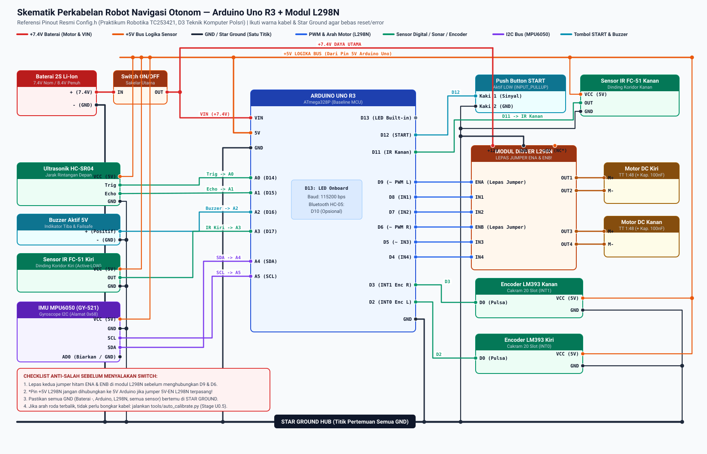
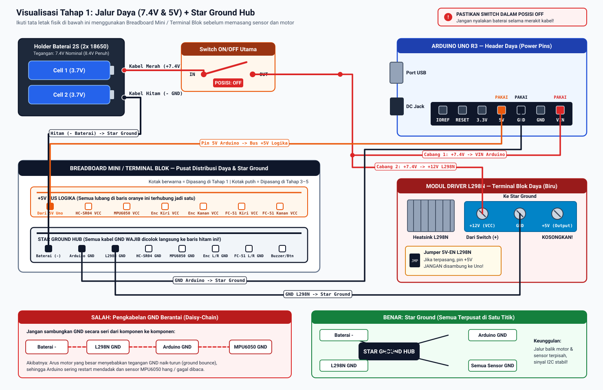
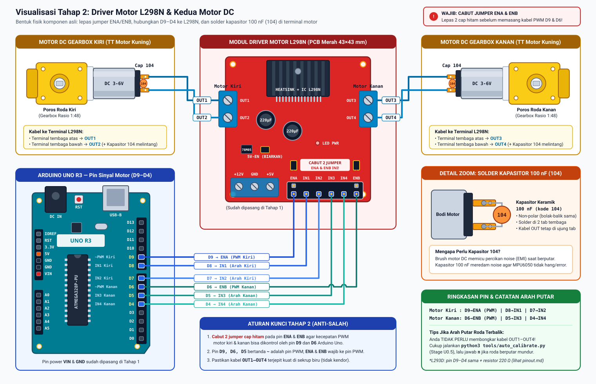
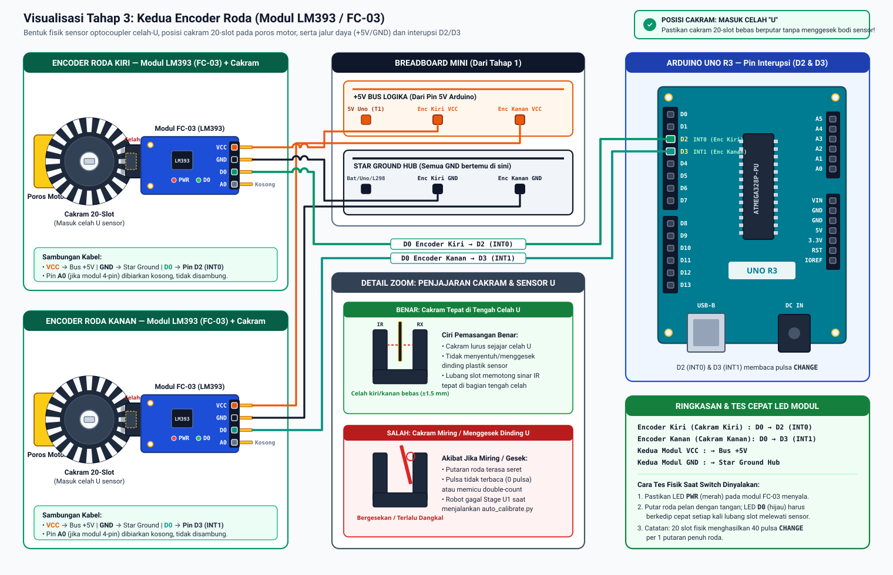
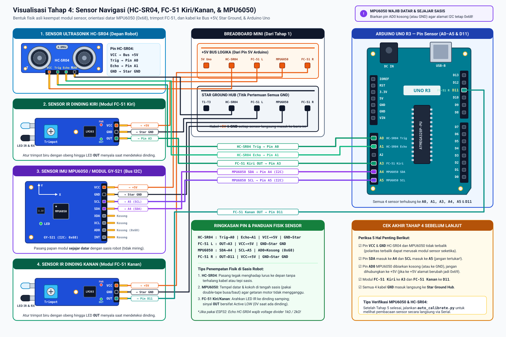
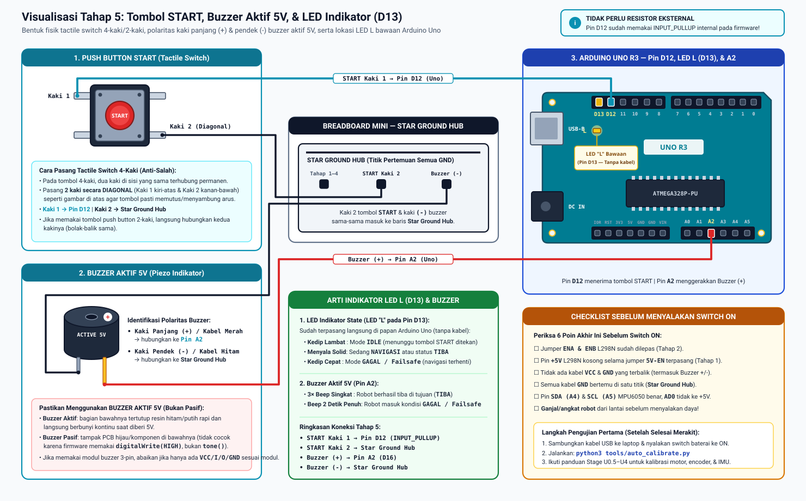

# Panduan Perakitan Skematik Perkabelan (Anti-Salah)

Panduan perakitan kabel langkah-demi-langkah untuk **Robot Navigasi Otonom (Arduino Uno R3 + Modul Driver L298N)**, disusun agar mahasiswa dapat merakit setiap komponen secara berurutan tanpa kesalahan polaritas, salah pin, maupun *ground loop*.

---

## Diagram Skematik Lengkap

> **Model 3D:** lihat rangkaian ini dalam 3D (41 kabel pada pin yang benar) di [renders/robot_iso.png](renders/robot_iso.png), [tampak atas](renders/robot_top.png), dan [tampak bawah](renders/robot_bottom.png). Cara membangunnya ada di [tools/README.md](../../tools/README.md#4-model-3d-rangkaian-blender-blender).

> **Tips Membaca Diagram:**
> - **Merah (`+7.4V`)**: Daya baterai menuju `VIN` Arduino dan `+12V` L298N.
> - **Oranye (`+5V`)**: Suplai logika 5V dari pin `5V` Arduino menuju semua sensor.
> - **Hitam (`GND`)**: Semua jalur ground wajib bertemu di satu titik (**Star Ground**).
> - **Biru**: Sinyal PWM dan arah motor (`D9`–`D4`) ke L298N.
> - **Hijau / Ungu / Biru Muda**: Sinyal sensor (`HC-SR04`, `LM393`, `FC-51`), bus I2C (`MPU6050`), dan antarmuka (`START` & `Buzzer`).

---

## Urutan Perakitan 5 Tahap (Rakit Sesuai Urutan Ini!)

### Tahap 1: Siapkan Jalur Daya & *Star Ground* (Switch dalam posisi OFF!)
> **Peringatan:** Pastikan baterai belum terhubung atau sakelar utama dalam keadaan **OFF** selama proses perakitan.

1. Siapkan satu titik terminal bersama (misalnya rel `-` breadboard mini atau terminal blok) sebagai **Star Ground Hub**.
2. Hubungkan kabel **Hitam (`-`) Baterai 2S 7.4V** ke **Star Ground Hub**.
3. Hubungkan kabel **Merah (`+`) Baterai 2S 7.4V** ke kaki `IN` **Switch ON/OFF Utama**.
4. Dari kaki `OUT` **Switch ON/OFF**, cabangkan dua kabel merah:
   - Cabang 1 $\rightarrow$ pin **`VIN`** Arduino Uno.
   - Cabang 2 $\rightarrow$ terminal **`+12V` (VCC)** modul **L298N**.
5. Hubungkan pin **`GND`** Arduino Uno dan terminal **`GND`** modul **L298N** ke **Star Ground Hub**.
6. Siapkan satu rel `+` terpisah sebagai **Bus `+5V` Logika**, lalu hubungkan ke pin **`5V`** Arduino Uno.
7. **Aturan Jumper `5V-EN` L298N:** Jika jumper kecil di belakang terminal daya L298N terpasang, **biarkan pin `+5V` L298N kosong (tidak perlu disambung ke `5V` Arduino)** agar regulator onboard L298N dan Arduino tidak saling bertabrakan.

---

### Tahap 2: Pasang Driver Motor L298N & Kedua Motor DC

1. **WAJIB:** Cabut/lepas kedua *jumper cap* hitam pada pin **`ENA`** dan **`ENB`** di modul L298N.
2. Sambungkan 6 kabel sinyal kontrol dari Arduino Uno ke L298N:

| Pin Arduino Uno | Pin Modul L298N | Fungsi |
| :---: | :---: | :--- |
| **`D9`** | **`ENA`** | Kecepatan (PWM) Motor **Kiri** |
| **`D8`** | **`IN1`** | Arah Motor **Kiri** |
| **`D7`** | **`IN2`** | Arah Motor **Kiri** |
| **`D6`** | **`ENB`** | Kecepatan (PWM) Motor **Kanan** |
| **`D5`** | **`IN3`** | Arah Motor **Kanan** |
| **`D4`** | **`IN4`** | Arah Motor **Kanan** |

3. Sambungkan kabel **Motor DC Kiri** ke terminal **`OUT1`** & **`OUT2`**, dan **Motor DC Kanan** ke terminal **`OUT3`** & **`OUT4`**.
4. *(Sangat Disarankan)* Solder **kapasitor keramik `100 nF` (kode `104`)** melintang di antara dua terminal tembaga masing-masing motor DC untuk meredam percikan EMI agar pembacaan MPU6050 stabil.

*(Catatan: Jika Anda menggunakan **IC L293D** alih-alih modul L298N, pin Arduino `D9–D4` tetap sama persis; lihat tabel padanan di [pinout.md](pinout.md) dan pasang resistor seri `220 Ω` pada `IN1–IN4` serta kapasitor `220 µF` pada `VCC2`.)*

---

### Tahap 3: Pasang Kedua Encoder Roda (LM393 / FC-03)

1. **Encoder Kiri** (dipasang pada cakram 20-slot roda kiri):
   - `VCC` $\rightarrow$ Bus **`+5V`**
   - `GND` $\rightarrow$ **Star Ground Hub**
   - `D0` $\rightarrow$ Pin **`D2` (INT0)** Arduino Uno
2. **Encoder Kanan** (dipasang pada cakram 20-slot roda kanan):
   - `VCC` $\rightarrow$ Bus **`+5V`**
   - `GND` $\rightarrow$ **Star Ground Hub**
   - `D0` $\rightarrow$ Pin **`D3` (INT1)** Arduino Uno

---

### Tahap 4: Pasang Sensor Navigasi (HC-SR04, MPU6050, & FC-51)

1. **Sensor Ultrasonik HC-SR04 (Depan):**
   - `VCC` $\rightarrow$ Bus **`+5V`**
   - `Trig` $\rightarrow$ Pin **`A0`** Arduino Uno
   - `Echo` $\rightarrow$ Pin **`A1`** Arduino Uno
   - `GND` $\rightarrow$ **Star Ground Hub**
2. **Sensor IMU MPU6050 / Modul GY-521 (I2C):**
   - `VCC` $\rightarrow$ Bus **`+5V`**
   - `GND` $\rightarrow$ **Star Ground Hub**
   - `SDA` $\rightarrow$ Pin **`A4`** Arduino Uno
   - `SCL` $\rightarrow$ Pin **`A5`** Arduino Uno
   - `AD0` $\rightarrow$ Biarkan kosong (tidak disambung) atau hubungkan ke `GND` agar alamat I2C tetap **`0x68`**.
   - *(Pemasangan fisik: pastikan posisi papan MPU6050 sejajar datar dengan sasis robot dan tidak miring).*
3. **Sensor IR Dinding Kiri (FC-51 Kiri):**
   - `VCC` $\rightarrow$ Bus **`+5V`**
   - `OUT` $\rightarrow$ Pin **`A3`** Arduino Uno
   - `GND` $\rightarrow$ **Star Ground Hub**
4. **Sensor IR Dinding Kanan (FC-51 Kanan):**
   - `VCC` $\rightarrow$ Bus **`+5V`**
   - `OUT` $\rightarrow$ Pin **`D11`** Arduino Uno
   - `GND` $\rightarrow$ **Star Ground Hub**

---

### Tahap 5: Pasang Tombol `START` & Buzzer Indikator

1. **Push Button `START`:**
   - Kaki 1 $\rightarrow$ Pin **`D12`** Arduino Uno
   - Kaki 2 $\rightarrow$ **Star Ground Hub**
   - *(Tidak perlu resistor eksternal karena firmware sudah mengaktifkan `INPUT_PULLUP` internal).*
2. **Buzzer Aktif 5V:**
   - Kaki `+` (positif / kabel merah) $\rightarrow$ Pin **`A2`** Arduino Uno
   - Kaki `-` (negatif / kabel hitam) $\rightarrow$ **Star Ground Hub**
3. **LED Indikator State:** Sudah tersedia langsung di papan Arduino Uno (LED `L` bawaan pada pin **`D13`**), tidak perlu kabel tambahan.

---

## Checklist Verifikasi Sebelum Menyalakan Switch

Periksa 6 poin berikut sebelum memindahkan sakelar baterai ke posisi **ON**:

- [ ] **Jumper `ENA` & `ENB` L298N sudah dilepas** sebelum kabel `D9` dan `D6` dipasang.
- [ ] **Pin `+5V` L298N tidak dihubungkan ke `5V` Arduino** (selama jumper `5V-EN` L298N terpasang).
- [ ] **Tidak ada kabel `VCC` dan `GND` yang terbalik** (terutama pada Baterai 7.4V, MPU6050, dan HC-SR04).
- [ ] **Semua kabel `GND` bertemu di satu titik (*Star Ground*)** — baterai, Arduino, L298N, dan semua sensor.
- [ ] **Pin `SDA` (`A4`) dan `SCL` (`A5`) MPU6050 tidak tertukar**, dan pin `AD0` tidak terhubung ke `5V`.
- [ ] **Robot diganjal/diangkat** dari lantai sebelum menjalankan pengujian pertama kali (`python3 tools/auto_calibrate.py`).

> **Catatan Jika Arah Putar Roda Terbalik:** Anda **tidak perlu** membongkar kabel `OUT1`–`OUT4` di terminal L298N. Cukup jalankan `python3 tools/auto_calibrate.py` (Stage U0.5), jawab `n` ketika ditanya apakah roda kiri/kanan berputar maju, maka firmware akan otomatis membalik arah motor di EEPROM.

---

## Catatan Jika Menggunakan Target ESP32 DevKit v1
Jika Anda menggunakan **ESP32 DevKit v1** (`#define BOARD_TYPE BOARD_ESP32` di `Config.h`), ikuti alur 5 tahap yang sama dengan penyesuaian pin pada [pinout.md](pinout.md#2-pemetaan-pin-portabilitas-esp32-devkit-v1-adr-0002), serta **wajib** memasang rangkaian *voltage divider* ($1\,\text{k}\Omega$ dan $2\,\text{k}\Omega$) pada sinyal **`Echo` HC-SR04** agar tegangan $5\text{ V}$ turun menjadi $3.3\text{ V}$ sebelum masuk ke `GPIO 18`.
