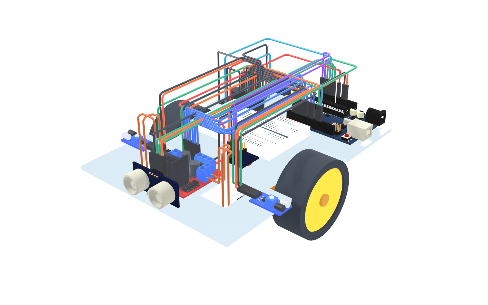

# Development Tools & Telemetry Utilities

Perangkat bantu pengujian offline dan analisis telemetri navigasi robot (Praktikum Robotika TC253421, D3 Teknik Komputer Polsri).

---

## 1. Simulator Navigasi Kinematika (`simulate_navigation.py`)

Simulator offline berbasis Python untuk memvalidasi algoritma Go-To-Goal, Finite State Machine (FSM 8-state), dan penghindaran rintangan dinamis tanpa memerlukan robot fisik.

### Fitur:
- Pemodelan kinematika *differential drive*.
- Geometri arena koridor 480 × 80 cm dan 4 ruangan tujuan (Room 1–4).
- Pengecekan *clearance* dinding koridor ($\ge 10\text{ cm}$) dan batas rintangan ($\ge 10\text{ cm}$).
- Verifikasi presisi lingkaran target ($R = 5\text{ cm}$, diameter $10\text{ cm}$).
- Ekspor telemetri format CSV standar: `tools/sample_telemetry.csv`.

### Cara Menjalankan:

```bash
# 1. Jalankan seluruh suite simulasi standar (Babak 1, 2, 3, dan 3-Alt):
python3 tools/simulate_navigation.py

# 2. Jalankan simulasi untuk ruangan tertentu (misal: Room 3) dan langsung buat plot lintasan SVG:
python3 tools/simulate_navigation.py --room 3 --plot

# 3. Jalankan simulasi dengan rintangan kustom (format 'x,y,w,h'):
python3 tools/simulate_navigation.py --room 2 --obs "110,0,20,20" --plot

# 4. Lihat seluruh opsi perintah:
python3 tools/simulate_navigation.py --help
```

---

## 2. Plotter Lintasan Telemetri (`plot_trajectory.py`)

Utilitas pengolah file CSV telemetri serial untuk menghasilkan diagram lintasan vektor (SVG) beresolusi tinggi untuk laporan akhir praktikum.

### Format Telemetri CSV:
File CSV input memiliki kolom header:
```csv
t_ms,state,x,y,theta,jarak,iWp
```

### Cara Menjalankan:
```bash
# Render file SVG dari telemetri
python3 tools/plot_trajectory.py tools/sample_telemetry.csv -o tools/trajectory_plot.svg
```

Diagram yang dihasilkan memvisualisasikan:
- Batas koridor 480 × 80 cm dan garis tengah (*centerline*).
- Pintu masuk dan lingkaran target Room 1, 2, 3, dan 4.
- Kotak rintangan $20 \times 20\text{ cm}$.
- Garis lintasan aktual robot berwarna biru.
- Titik START $(0, 0)$ hijau dan titik TIBA merah beserta koordinat akhir.

---

## 3. Wizard Kalibrasi & Diagnostik Pre-Flight (`auto_calibrate.py`)

Utilitas interaktif berbasis terminal (CLI) untuk mengeksekusi pengujian perangkat keras Pre-Flight (Stage U0), penguncian keamanan (*hard-gated safety*), serta kalibrasi parameter kinematika robot secara dinamis (Stage U1–U4) tanpa kompilasi ulang kode sumber.

### Fitur Stage U0 (Pre-Flight Hardware Diagnostics):
- **U0.1 MPU6050 I2C Bus & Orientasi**: Memeriksa register `WHO_AM_I` pada address 0x68 (Pin SDA A4, SCL A5), lalu menanyakan orientasi modul (chip menghadap atas/bawah/tegak + arah panah X) dan menyimpan `gyroSign` (`+1`/`-1`) ke EEPROM. Modul tegak ditolak. Dapat diubah ulang lewat menu individual **[8] Atur Orientasi MPU6050**.
- **U0.2 Sonar Ultrasonik HC-SR04**: Validasi pantulan echo bebas timeout (Trig A0, Echo A1).
- **U0.3 Sensor IR Lateral FC-51**: Pengujian logika active-low sensor dinding kiri (A3) dan kanan (D11).
- **U0.4 Indikator Buzzer & LED**: Pengujian audio-visual buzzer piezo (A2) dan status LED (D13).
- **U0.5 Motor Driver & Dual Encoder**: Memutar roda independen, memverifikasi pembacaan pulsa optical encoder (D2/D3), dan otomatis mengaplikasikan *software polarity inversion* ke EEPROM jika arah putaran terbalik.
- **Hard-Gated Safety**: Memblokir kalibrasi gerak jika salah satu komponen hardware gagal dan menampilkan petunjuk perbaikan pin perkabelan (*wiring repair*).

### Fitur Stage U1–U4 (Kinematic Calibration & Auto-Convergence):
- **U1 Pulsa Encoder & Diameter Roda**: Melakukan translasi 100 cm, menangkap pulsa encoder ($P_L, P_R$), menghitung rasio ketidakseimbangan motor, memperbarui diameter roda efektif ($D_{\text{baru}}$), serta mengulang hingga toleransi terpenuhi ($\Delta D \le 3.0\text{ cm}$, drift pulsa $\le 3\%$).
- **U2 Zero-Bias & Rotasi Gyro In-Place**: Melakukan sampling zero-bias Z-axis selama 2 detik saat robot diam dan menguji rotasi in-place $\pm 90^\circ$ (toleransi galat sudut $\le 5.0^\circ$).
- **U3 Lintasan Lurus Berpemandu Gyro**: Uji translasi 150 cm dengan koreksi kemudi proporsional heading aktif untuk memverifikasi kestabilan koridor (toleransi deviasi lateral $\le 5.0\text{ cm}$).
- **U4 Akurasi Ranging Ultrasonik HC-SR04**: Menguji akurasi jarak sonar pada 10, 20, dan 40 cm terhadap mistar ground truth (toleransi galat $\le 1.0\text{ cm}$).
- **Logging Telemetri CSV Otomatis**: Seluruh riwayat pengujian, nilai sensor mentah, input ground truth, dan parameter ter-tuning diekspor otomatis ke `tools/calibration_log.csv`.
- **Mode Seleksi Operasional**: Mendukung `Full Calibration Wizard` (U0 $\rightarrow$ U4) dan `Individual Test Mode` (menu interaktif atau flag `--test`).

### Cara Menjalankan:

> Mode robot fisik membutuhkan `pyserial` dari *virtual environment* proyek: aktifkan dulu dengan `source .venv/bin/activate` (cara membuatnya ada di [README utama](../README.md#cara-instalasi-prasyarat-software)). Mode `--mock` tidak membutuhkan pyserial.

```bash
# 1. Jalankan pengujian interaktif terhadap robot fisik (autodetect port serial):
python3 tools/auto_calibrate.py

# 2. Tentukan port serial dan jalankan menu mode individual:
python3 tools/auto_calibrate.py --port /dev/ttyUSB0 --baud 9600 --mode individual

# 3. Jalankan pengujian offline/CI dengan mock robot firmware:
python3 tools/auto_calibrate.py --mock --headless

# 4. Jalankan pengujian spesifik secara langsung (misal: U1 saja):
python3 tools/auto_calibrate.py --mock --headless --test U1

# 5. Uji simulasi kegagalan sensor tertentu pada mock mode:
python3 tools/auto_calibrate.py --mock --fail-mpu
python3 tools/auto_calibrate.py --mock --fail-sonar
python3 tools/auto_calibrate.py --mock --reverse-left
```

---

## 4. Model 3D Rangkaian (Blender) (`blender/`)

Membangun `build/robot_3d.blend`, yaitu robot 2WD lengkap (sasis akrilik, motor TT, Uno R3, L298N, sensor) dengan **41 kabel** yang menancap di pin yang benar sesuai [`docs/hardware/wiring-schematic.md`](../docs/hardware/wiring-schematic.md). Render-nya ada di [`docs/hardware/renders/`](../docs/hardware/renders/).



### Prasyarat:
- **Blender 5.3** di `/Applications/Blender.app` (atau set `BLENDER=/path/ke/blender`).
- **Koneksi internet** untuk mengunduh model sekali (`make blender_fetch`), dan **Python 3.12** untuk konverter STEP (`cadquery-ocp` dipasang otomatis ke `.venv/` repo).
- Model unduhan **tidak di-commit** (sebagian tanpa lisensi redistribusi). Sumber, lisensi, dan atribusinya ada di [`assets/3d/SOURCES.md`](../assets/3d/SOURCES.md).

### Cara Menjalankan:

```bash
# 1. Unduh model (hash SHA-256 diverifikasi) ke assets/3d/vendor/
make blender_fetch

# 2. Konversi STEP -> GLB, rakit robot, periksa 41 kabel, simpan .blend, dan render 3 PNG
make blender_model

# 3. (Opsional) Close-up setiap header untuk memeriksa letak housing dupont
"/Applications/Blender.app/Contents/MacOS/Blender" -b --factory-startup --python-exit-code 1 \
  -P tools/blender/build_robot.py -- --out build/robot_3d.blend --no-render --closeups build/renders/closeup
```

Build akan **gagal (exit 1)** jika ada kabel yang ujungnya meleset lebih dari 0.5 mm dari pinnya, ada kabel yang menembus badan komponen, atau jumlah kabelnya bukan 41. Baris terakhir yang menandakan sukses adalah `ROBOT MODEL OK: 41 wires, 25 parts`.

### Membuka Model:
Buka `build/robot_3d.blend` di Blender. Di Outliner, objek dikelompokkan menjadi collection **Chassis**, **Electronics**, dan **Wires** → *Tahap 1 – Daya* … *Tahap 5 – START & Buzzer*. Klik ikon mata pada sebuah tahap untuk menyembunyikan atau menampilkan kabelnya, mengikuti urutan perakitan 5 tahap. Setiap kabel bernama `wire_<net>_<komponen.pin>_<komponen.pin>`.

### Struktur Modul:
| Berkas | Isi |
| :--- | :--- |
| `netlist.py` | 41 kabel (sumber kebenaran), dicek terhadap `Config.h` dan `wiring-schematic.md` oleh `tests/test_blender_netlist.py` |
| `layout.py`, `routing.py` | Posisi setiap komponen di sasis serta rute kabel ortogonal dan lane (Python murni, dites di `make test`) |
| `fetch_models.py`, `convert_step.py`, `assets.py` | Manifest `assets/3d/sources.json`, unduhan terverifikasi hash, dan konversi STEP → GLB |
| `bl_parts.py`, `bl_import.py` | Komponen prosedural dan import model unduhan, dinormalisasi oleh `assets/3d/anchors.json` (koordinat pin) |
| `bl_wires.py`, `bl_checks.py`, `build_robot.py` | Kabel dupont/telanjang, pemeriksaan scene, dan rakitan penuh + render |
| `check_parts.py`, `measure_model.py` | Pemeriksa dimensi/anchor setiap part dan alat bantu ukur pin |

---

## 5. Konsol Serial Robot (`serial_console.py`)

Konsol baris-per-baris untuk berbicara dengan robot lewat USB atau Bluetooth HC-05, pengganti `serial.tools.miniterm` yang lebih ramah: ketikan terlihat, satu baris dikirim per Enter (diakhiri satu `\n`), keluar dengan `exit` atau `Ctrl+C` dan port **selalu dilepas**, port dikunci eksklusif (bila sedang dipakai program lain, konsol menampilkan perintah `lsof`/`kill` untuk membebaskannya), telemetri dapat langsung disimpan sebagai CSV siap plot, dan saat port dibuka konsol mengulang `!PING` (maks. 10 detik, matikan dengan `--no-handshake`) sampai robot menjawab — menutupi beberapa detik yang dibutuhkan tautan Bluetooth HC-05 atau reset otomatis Uno lewat USB. Membutuhkan `pyserial` dari venv proyek (`source .venv/bin/activate`).

```bash
# Interaktif: ketik !PING, !DIAG:ALL, !DIAG:MOTOR:150:0:1000, angka ruangan 1-4, ... lalu 'exit'
python3 tools/serial_console.py --port /dev/cu.HC-05

# Rekam uji arena: hanya baris telemetri ke CSV (siap plot_trajectory.py), semua baris ke log
python3 tools/serial_console.py --port /dev/cu.HC-05 --csv babak1_room2.csv --log babak1_room2.txt

# Non-interaktif (skrip/CI): tunggu robot menjawab !PING, kirim perintah, rekam 3 s, keluar
python3 tools/serial_console.py --port /dev/cu.usbmodem14101 --send '!PING' --send '!DIAG:ALL' --duration 3
```
